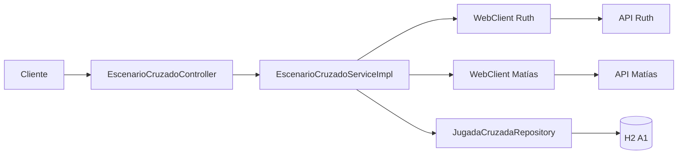
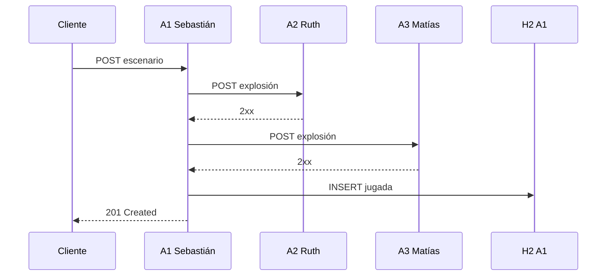

# Entrega Classroom - POO-09 Minecraft

Alumno: Sebastián Gómez de la Fuente

Usuario GitHub: SGDFM

Repositorio: https://github.com/SGDFM/sgomezdelafuente-talle-git-2026

Commit de solución POO-09: https://github.com/SGDFM/sgomezdelafuente-talle-git-2026/commit/c5e3a8a8e7913d0cc4d34f8cceb228faa2205920

## Objetivo

Publicar la API propia mediante OpenAPI y Swagger UI, consumir con `WebClient` las APIs REST de dos compañeros y resolver un escenario coordinado. A1 persiste la jugada en su H2 únicamente cuando A2 y A3 responden exitosamente.

## Integrantes y responsabilidades

| Rol | Integrante | Repositorio | Responsabilidad integrada |
|---|---|---|---|
| A1 | Sebastián Gómez de la Fuente | https://github.com/SGDFM/sgomezdelafuente-talle-git-2026 | Orquestación, respuesta HTTP y persistencia local. |
| A2 | Ruth Santacruz | https://github.com/ruthsantacruzuca/rsantacruz-taller-git-2026 | Explosión y reacción en cadena. |
| A3 | Matías Duarte | https://github.com/Cemelele/mfdc-taller-git-2026 | Radio, víctimas y ciclo de vida del Creeper. |

Los repositorios A2 y A3 no publicaban documentos OpenAPI al momento de la implementación. Los adaptadores se construyeron contra sus contratos REST POO-08 visibles y permiten cambiar URL y ruta mediante configuración.

## Contrato propio

```text
GET  /v3/api-docs
GET  /swagger-ui.html
POST /minecraft/sgomezdelafuente/escenarios/explosiones
GET  /minecraft/sgomezdelafuente/escenarios/explosiones
```

El POST coordinado puede responder:

| Estado | Significado |
|---|---|
| `201` | A2 y A3 aceptaron; A1 persistió la jugada. |
| `400` | El pedido local no tiene los datos obligatorios. |
| `422` | A2 o A3 rechazó su regla; la respuesta identifica al compañero. |
| `502` | No fue posible contactar al compañero identificado. |

## APIs consumidas

```text
A2 Ruth:   POST http://localhost:8081/api/minecraft/simulaciones/explosion
A3 Matías: POST http://localhost:8082/api/simulaciones/explosion
```

Variables admitidas:

```text
RUTH_BASE_URL
RUTH_EXPLOSION_PATH
MATIAS_BASE_URL
MATIAS_EXPLOSION_PATH
```

## Ejecución

Iniciar A2, A3 y A1 en puertos diferentes:

```bash
# A2
SERVER_PORT=8081 ./mvnw spring-boot:run

# A3
SERVER_PORT=8082 ./mvnw spring-boot:run

# A1
./mvnw spring-boot:run
```

A2 y A3 deben tener previamente Creepers y víctimas válidos en sus bases. Los IDs se colocan en la colección Insomnia.

## Camino feliz

```json
{
  "descripcion": "Explosión coordinada en una mina",
  "ruth": {
    "creeperId": 1
  },
  "matias": {
    "creeperId": 1,
    "cargado": true,
    "encendido": true,
    "victimas": [
      {
        "hostilId": 2,
        "distancia": 2.0
      }
    ]
  }
}
```

Secuencia:

1. A1 valida el pedido.
2. A1 consulta a Ruth mediante `WebClient`.
3. Si Ruth acepta, A1 consulta a Matías.
4. Si Matías acepta, `JugadaCruzadaRepository` inserta la jugada en H2.
5. A1 responde `201` con el ID generado.

## Rechazos y persistencia

Un error remoto se convierte en `IntegracionErrorResponse`, que conserva el estado y cuerpo remotos e identifica `A2 - Ruth Santacruz` o `A3 - Matías Duarte`. Si A2 rechaza, A3 no es consultado. Si cualquiera rechaza, A1 no inserta una fila.

La garantía transaccional corresponde a la H2 de A1. No hay una transacción distribuida que pueda revertir un efecto ya realizado dentro de A2 antes de un eventual rechazo de A3.

## Logging

Log4j2 conserva el nivel raíz en `INFO` y habilita `DEBUG` para los clientes de integración y `EscenarioCruzadoServiceImpl`. Las trazas muestran inicio, compañero consultado, estado y cuerpo remoto, aceptación y persistencia local.

## Insomnia

Importar:

```text
insomnia/poo-09-integracion.json
```

La colección contiene:

1. Consulta del documento OpenAPI.
2. Escenario aceptado por A2 y A3.
3. Rechazo de Ruth con un Creeper inexistente.
4. Rechazo de Matías con un Creeper inexistente.
5. GET de jugadas aceptadas y persistidas.

Antes de ejecutar se deben actualizar los IDs del entorno con registros reales de A2 y A3. Cada explosión puede cambiar el estado remoto; para repetir una evidencia se deben preparar nuevos datos.

## Arquitectura





## Pruebas

```bash
./mvnw test
```

Resultado: 35 pruebas, 0 fallos y 0 errores. POO-09 verifica el camino feliz, los rechazos de A2 y A3, la indisponibilidad `502`, la ausencia de persistencia ante errores, `/v3/api-docs` y la redirección de Swagger UI.
