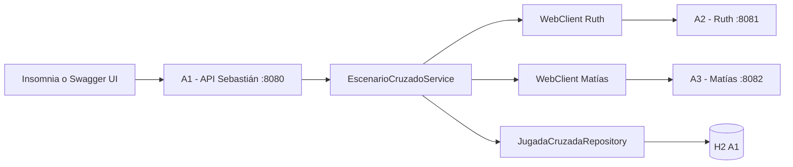
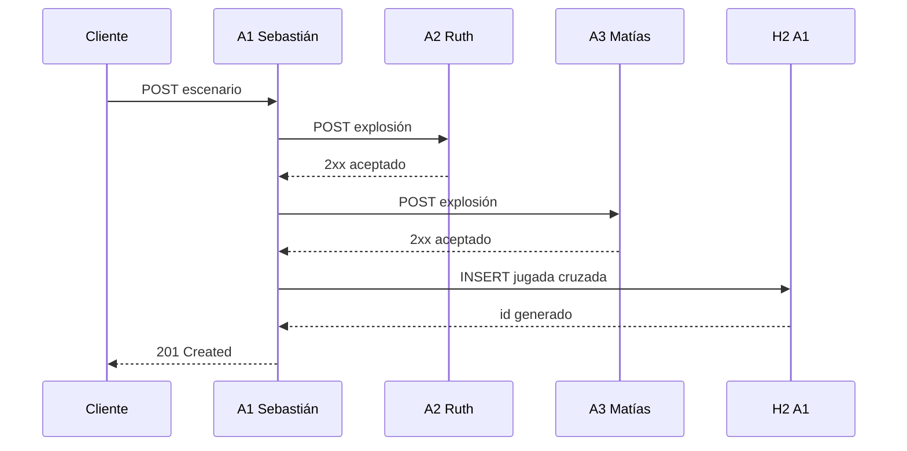
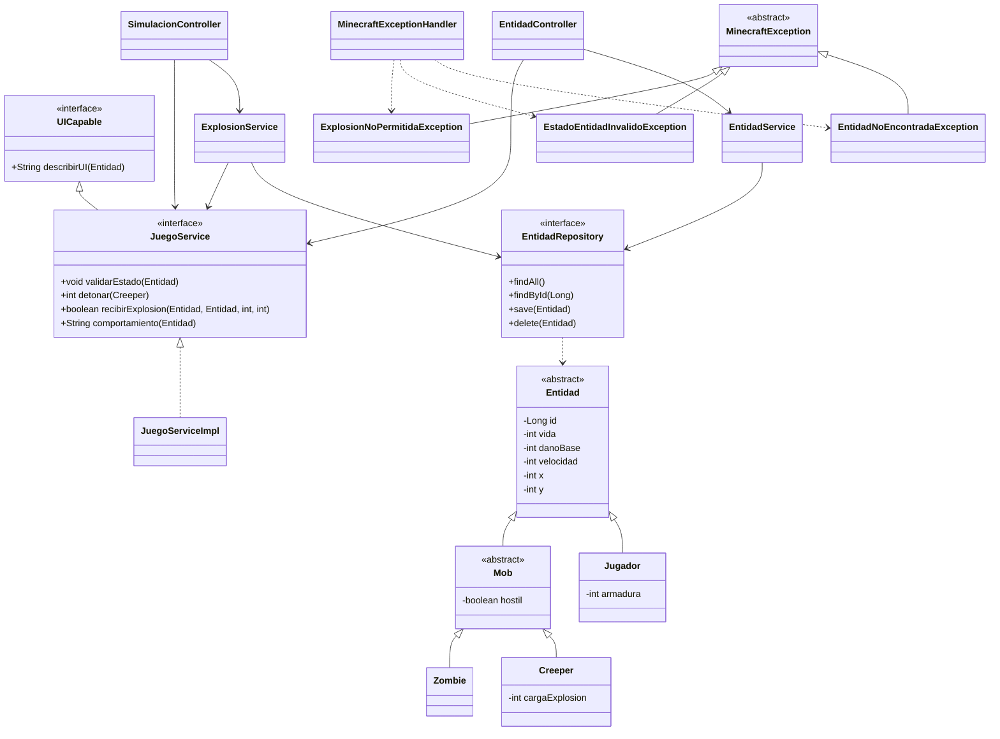

# sgomezdelafuente-talle-git-2026

Nombre: Sebastián Gómez de la Fuente

Usuario GitHub: SGDFM

Comisión: CYT646 F

Dominio: Minecraft

Commit de solución POO-08: https://github.com/SGDFM/sgomezdelafuente-talle-git-2026/commit/58861f5135afe589ed34f2985874d3ef0c0087ef

Commit de solución POO-09 corregida: pendiente de commit local; no publicado.

Commit anterior POO-06: https://github.com/SGDFM/sgomezdelafuente-talle-git-2026/commit/6e25498a38db875b3a97d32a17b47dc2e4885234

## Objetivo POO-09

Publicar el contrato de la API con OpenAPI y Swagger UI, consumir con `WebClient` las APIs de dos compañeros y ejecutar un escenario cruzado. En esta entrega Sebastián ocupa el rol A1 y guarda la jugada propia en H2 únicamente cuando Ruth (A2) y Matías (A3) aceptan sus respectivas reglas.

## Mapa del grupo

| Rol | Integrante | Repositorio | Uso |
|---|---|---|---|
| A1 | Sebastián Gómez de la Fuente | [SGDFM](https://github.com/SGDFM/sgomezdelafuente-talle-git-2026) | Orquesta y persiste el escenario cruzado. |
| A2 | Ruth Santacruz | [ruthsantacruzuca](https://github.com/ruthsantacruzuca/rsantacruz-taller-git-2026) | Valida explosión y reacción en cadena. |
| A3 | Matías Duarte | [Cemelele](https://github.com/Cemelele/mfdc-taller-git-2026) | Valida radio, víctimas y ciclo de vida del Creeper. |

Ruth ya publica POO-09 y OpenAPI en `main` (`fd6aebe`). Matías mantiene su avance POO-09 y OpenAPI en `feature/RESTClient` (`f3d717a`), todavía no fusionado a `main`; su endpoint de explosión consumido por A1 sí existe en `main`. Las rutas y URLs quedaron externalizadas para poder ajustarlas sin recompilar.

## OpenAPI y Swagger UI

Con A1 en ejecución:

```text
OpenAPI JSON: http://localhost:8080/v3/api-docs
Swagger UI:   http://localhost:8080/swagger-ui.html
```

Todos los controladores propios están publicados en el documento. El escenario cruzado informa las respuestas `201`, `400`, `422` y `502`.

## Arranque integrado

Los tres proyectos deben usar puertos diferentes. Primero se deben iniciar A2 y A3 con datos válidos en sus respectivas H2; luego se inicia A1:

```bash
# Repositorio de Ruth (A2)
SERVER_PORT=8081 ./mvnw spring-boot:run

# Repositorio de Matías (A3)
SERVER_PORT=8082 ./mvnw spring-boot:run

# Este repositorio (A1)
./mvnw spring-boot:run
```

Configuración admitida por A1:

| Variable | Valor predeterminado |
|---|---|
| `RUTH_BASE_URL` | `http://localhost:8081` |
| `RUTH_EXPLOSION_PATH` | `/api/minecraft/simulaciones/explosion` |
| `MATIAS_BASE_URL` | `http://localhost:8082` |
| `MATIAS_EXPLOSION_PATH` | `/api/simulaciones/explosion` |

## Escenario cruzado

Endpoint coordinador:

```text
POST /minecraft/sgomezdelafuente/escenarios/explosiones
GET  /minecraft/sgomezdelafuente/escenarios/explosiones
```

Ejemplo de entrada, cuyos IDs deben existir en las bases de A2 y A3:

```json
{
  "descripcion": "Explosión coordinada en una mina",
  "ruth": {
    "creeperId": 1
  },
  "matias": {
    "creeperId": 1,
    "cargado": true,
    "encendido": true,
    "victimas": [
      {
        "hostilId": 2,
        "distancia": 2.0
      }
    ]
  }
}
```

Flujo aplicado:

1. A1 valida la estructura local.
2. `WebClientRuthExplosionClient` consulta A2.
3. Solo si A2 acepta, `WebClientMatiasExplosionClient` consulta A3.
4. Solo si A3 también acepta, A1 inserta una fila en `JUGADAS_CRUZADAS`.
5. Un rechazo remoto produce `422` e identifica al compañero; una conexión fallida produce `502`.

La transacción garantiza que un rechazo no inserta una jugada en la H2 de A1. No existe una transacción distribuida entre los tres procesos: si A2 modifica su propia base antes de que A3 rechace, A1 no puede deshacer ese efecto remoto.

Los clientes y el orquestador registran en nivel `DEBUG` cada consulta, estado remoto, aceptación y persistencia, sin cambiar el nivel `INFO` del resto de la aplicación. Cada cliente limita la conexión a 3 segundos y la espera de respuesta a 5 segundos.

### Validación real en VM

Se levantaron simultáneamente el commit publicado `fd6aebe` de Ruth en `8081`, el commit `e24255e` de Matías en `8082` y esta aplicación en `8080`, todos con H2 en memoria. El camino feliz respondió `201` y persistió una sola jugada en A1. Un Creeper inexistente de A2 y otro de A3 produjeron respuestas `422` que identificaron al compañero y no agregaron filas locales. Al detener A2, A1 respondió `502`, identificó a Ruth y mantuvo la única fila aceptada.

## Diagramas POO-09





## Objetivo POO-08

Publicar una API REST con arquitectura de tres capas que persiste instancias de `Jugador`, `Creeper` y `Zombie` en H2. El servicio ofrece un CRUD polimórfico de `Entidad`, un endpoint basado en la interfaz `UICapable`, una simulación persistida de explosiones y respuestas HTTP diferentes para cada excepción del servicio.

## Requisitos

- JDK 21.
- Puerto 8080 disponible.
- Maven Wrapper incluido en el repositorio.

## Licencia

Este proyecto está licenciado bajo Apache License 2.0. Consulte [LICENSE](LICENSE).

## Cómo arrancar

```bash
./mvnw spring-boot:run
```

La API queda disponible en:

```text
http://localhost:8080
```

## Configuración H2

```properties
spring.application.name=minecraft-taller-git-2026
spring.datasource.url=jdbc:h2:file:./data/entidades
spring.datasource.username=sa
spring.datasource.password=
spring.jpa.hibernate.ddl-auto=update
spring.jpa.open-in-view=false
spring.h2.console.enabled=true
```

| Propiedad | Explicación |
|---|---|
| `spring.datasource.url` | Guarda la base en `./data/entidades`, por lo que los datos permanecen entre reinicios. |
| `spring.datasource.username` | Usa el usuario local `sa` de H2. |
| `spring.datasource.password` | Deja la contraseña vacía solo para desarrollo local. |
| `spring.jpa.hibernate.ddl-auto=update` | Crea o actualiza el esquema sin borrar los datos existentes. |
| `spring.jpa.open-in-view=false` | Cierra el contexto de persistencia antes de serializar la respuesta HTTP. |
| `spring.h2.console.enabled=true` | Habilita la consola web de H2 en desarrollo. |

Consola H2:

```text
http://localhost:8080/h2-console
```

Conexión:

```text
JDBC URL: jdbc:h2:file:./data/entidades
User Name: sa
Password: (vacío)
```

El directorio `data/` está ignorado por Git.

## Arquitectura

```text
rest/controller -> service -> repository -> H2
       |               |
       v               v
   DTO HTTP        dominio Minecraft
```

- `domain.minecraft`: entidades JPA que conservan únicamente el estado.
- `repository`: interfaces Spring Data JPA.
- `service`: contratos, reglas y excepciones de negocio.
- `service.impl`: validaciones, transacciones, cálculos y cambios de estado.
- `rest.controller`: traducción entre HTTP y servicios.
- `rest.dto`: cuerpos de entrada y salida.
- `rest.handler`: conversión de excepciones a JSON y estados HTTP.

El controlador no accede directamente al repositorio. Las entidades no validan ni lanzan excepciones: `EntidadServiceImpl`, `JuegoServiceImpl` y `ExplosionServiceImpl` concentran esas responsabilidades. La base H2 es la única fuente de estado del CRUD.

## Familia persistida

`Entidad` es la raíz abstracta. La persistencia usa `SINGLE_TABLE`, porque el CRUD necesita consultar la familia completa y distinguir subtipos en una sola colección.

Subtipos persistidos:

- `Jugador`.
- `Creeper`.
- `Zombie`.

La columna discriminadora `tipo_entidad` identifica el subtipo en H2. En HTTP, Jackson usa el campo `tipo` de `EntidadRequest`:

```json
{
  "tipo": "CREEPER",
  "vida": 20,
  "danoBase": 0,
  "velocidad": 2,
  "cargaExplosion": 4
}
```

La creación no recibe `id`; H2 lo asigna con `GenerationType.IDENTITY`.

JPA necesita un constructor sin argumentos. `Entidad`, `Mob` y `Zombie` lo exponen como `protected`, para que Hibernate pueda hidratar objetos sin convertir el constructor en una forma pública de crear estados incompletos. `Jugador` y `Creeper` conservan constructores públicos simples, válidos según la consigna de sobrecarga. Los constructores y mutadores solo asignan estado; los servicios validan antes de persistir o ejecutar una regla.

## Endpoints

| Método | URL | Resultado |
|---|---|---|
| `GET` | `/` | Confirma que la aplicación está activa. |
| `POST` | `/minecraft/sgomezdelafuente/entidades` | Crea un subtipo y responde `201` con su `id`. |
| `GET` | `/minecraft/sgomezdelafuente/entidades` | Lista la familia persistida. |
| `GET` | `/minecraft/sgomezdelafuente/entidades/{id}` | Busca una entidad o responde `404`. |
| `PUT` | `/minecraft/sgomezdelafuente/entidades/{id}` | Reemplaza el estado editable y lo persiste. |
| `DELETE` | `/minecraft/sgomezdelafuente/entidades/{id}` | Elimina la fila y responde `204`. |
| `GET` | `/minecraft/sgomezdelafuente/entidades/ui` | Pide `describirUI()` mediante `UICapable`. |
| `POST` | `/minecraft/sgomezdelafuente/simulaciones/explosion` | Ejecuta y persiste la simulación. |
| `POST` | `/minecraft/sgomezdelafuente/escenarios/explosiones` | A1 consulta A2 y A3; persiste solamente si ambos aceptan. |
| `GET` | `/minecraft/sgomezdelafuente/escenarios/explosiones` | Lista las jugadas cruzadas aceptadas. |
| `GET` | `/minecraft/sgomezdelafuente/comportamientos` | Conserva la demostración polimórfica de POO-06. |

## Ejemplos de curl para el CRUD

Crear Creeper:

```bash
curl -i -X POST http://localhost:8080/minecraft/sgomezdelafuente/entidades \
  -H "Content-Type: application/json" \
  -d '{"tipo":"CREEPER","vida":20,"danoBase":0,"velocidad":2,"cargaExplosion":4}'
```

Listar:

```bash
curl -i http://localhost:8080/minecraft/sgomezdelafuente/entidades
```

Buscar por ID:

```bash
curl -i http://localhost:8080/minecraft/sgomezdelafuente/entidades/1
```

Actualizar con PUT:

```bash
curl -i -X PUT http://localhost:8080/minecraft/sgomezdelafuente/entidades/1 \
  -H "Content-Type: application/json" \
  -d '{"tipo":"CREEPER","vida":20,"danoBase":0,"velocidad":3,"cargaExplosion":5}'
```

Eliminar:

```bash
curl -i -X DELETE http://localhost:8080/minecraft/sgomezdelafuente/entidades/1
```

## Interfaz UICapable

`UICapable` declara el mensaje:

```java
String describirUI(Entidad entidad);
```

`JuegoService` extiende el protocolo y `JuegoServiceImpl` lo implementa. El servicio recibe cualquier `Entidad` y produce la descripción correspondiente sin colocar lógica de presentación en las entidades. `Jugador` pertenece a la rama directa de `Entidad`; `Creeper` y `Zombie` pertenecen a la rama `Mob`.

Ejemplo de mensaje:

```text
imagen=creeper.png, posición=(0,0), sonido=siseo, velocidad=2, cargaExplosion=4
```

La imagen y el sonido son textos; no hay archivos binarios. El endpoint `/entidades/ui` obtiene las entidades vivas del servicio y solicita cada mensaje mediante el contrato `UICapable` heredado por `JuegoService`.

## Reglas de explosión

Regla 1: un `Creeper` solo puede detonar si está vivo y su carga es de al menos `3`; el daño base de la explosión es `cargaExplosion * 4`.

Regla 2: una entidad viva recibe el daño solo si su distancia de Manhattan respecto del Creeper no supera el radio; `JuegoServiceImpl` reduce el daño del `Jugador` según su armadura.

La simulación involucra un `Creeper`, un `Jugador` y un `Zombie`. Al terminar, el Creeper desaparece, los objetivos cercanos reciben daño y los tres estados se guardan dentro de una transacción.

Ejemplo:

```bash
curl -i -X POST http://localhost:8080/minecraft/sgomezdelafuente/simulaciones/explosion \
  -H "Content-Type: application/json" \
  -d '{"creeperId":1,"jugadorId":2,"zombieId":3,"radio":5}'
```

Un `GET /entidades` posterior confirma que el resultado permanece en H2.

## Excepciones

La jerarquía usa excepciones no comprobadas porque representan infracciones de reglas de las que el método que las detecta no puede recuperarse y Spring puede propagarlas al manejador HTTP.

```text
MinecraftException
|- EntidadNoEncontradaException  -> 404 Not Found
|- EstadoEntidadInvalidoException -> 400 Bad Request
`- ExplosionNoPermitidaException -> 409 Conflict
```

Los servicios lanzan la excepción correspondiente. `MinecraftExceptionHandler` tiene un método `@ExceptionHandler` diferente para cada subclase y responde con un JSON que contiene fecha, estado, tipo, mensaje y ruta.

## Decisiones de diseño

### Recurso y verbo

El sustantivo principal es `entidades`. La URL identifica la colección o un elemento; `POST`, `GET`, `PUT` y `DELETE` expresan la operación.

### Identidad

`Entidad.id` es la clave primaria. H2 la asigna al insertar, por eso el JSON de creación la omite.

### Herencia y tablas

Se eligió `SINGLE_TABLE` para consultar la familia polimórfica desde un solo `EntidadRepository`. Las columnas exclusivas de un subtipo pueden ser nulas en filas de otro subtipo; los servicios sostienen los invariantes antes de guardar.

### Interfaz y repositorio

`EntidadRepository` es una interfaz Spring Data. El servicio depende del contrato y no de SQL ni de H2. Si se cambia la base de datos por otra compatible con JPA, el dominio y los controladores permanecen iguales.

Además del CRUD generado, el repositorio declara `findByVidaGreaterThanOrderByIdAsc(int)`. El servicio lo usa para entregar al endpoint UI solamente elementos vivos y ordenados.

`UICapable` es un contrato de la capa de servicio. Su endpoint pide el mensaje a través de la interfaz y mantiene la lógica fuera de las entidades.

### Ocultamiento

Los DTO de entrada crean objetos mediante constructores que solo asignan estado. `EntidadServiceImpl` rechaza una vida fuera del intervalo de 1 a 20, valores negativos, tipos no persistibles, cambios de subtipo y cualquier modificación de una entidad muerta. `JuegoServiceImpl` valida las reglas del juego y `ExplosionServiceImpl` coordina la simulación. Un POST ilegal responde `400` y no inserta una fila.

La deserialización también rechaza propiedades desconocidas y números decimales en campos enteros. La carga se limita al máximo que permite calcular `cargaExplosion * 4` sin overflow, y la distancia usa aritmética `long` para soportar coordenadas extremas. Un PUT conserva la posición existente y una segunda detonación del mismo Creeper responde `409` sin alterar nuevamente las víctimas.

### PUT

`PUT` recibe todo el estado editable del subtipo. Conserva `id`, posición y tipo. Un tipo diferente al persistido responde `400`; un campo omitido toma el valor predeterminado del JSON y puede ser rechazado por las validaciones.

### DELETE

DELETE significa quitar el recurso de la colección persistida. Borrar es una operación de almacenamiento diferente de asignar vida cero durante una regla del juego.

### Dos reglas y simulación

La carga mínima decide si el Creeper puede detonar. El radio determina qué objetivos reciben daño. `ExplosionServiceImpl` coordina la transacción y delega los cálculos y cambios de estado en `JuegoService`; las entidades no ejecutan reglas.

Si una regla falla, la excepción aborta la transacción. Por eso una explosión sin carga no deja al Creeper ni a los objetivos parcialmente modificados.

### Cambio de base

Al cambiar H2 por otra base JPA se modifican dependencias y propiedades de conexión. Las entidades pueden requerir ajustes de dialecto o estrategia, pero los controladores y contratos de servicio permanecen separados de la persistencia.

## Insomnia

Colección versionada:

```text
insomnia/poo-08-minecraft.json
insomnia/poo-09-integracion.json
```

Importación:

1. Abrir Insomnia.
2. Elegir Import/Export.
3. Importar `insomnia/poo-08-minecraft.json`.
4. Verificar `base_url=http://localhost:8080`.

Orden de ejecución:

1. Crear Creeper, Jugador y Zombie.
2. Copiar los IDs devueltos a las variables del entorno.
3. Ejecutar GET de colección y GET por ID.
4. Ejecutar PUT y confirmar con otro GET.
5. Ejecutar el endpoint `UICapable`.
6. Ejecutar la simulación exitosa.
7. Ejecutar GET de colección y comprobar el estado persistido.
8. Ejecutar POST ilegal, ID inexistente y explosión sin carga.
9. Ejecutar DELETE y confirmar luego el `404`.

La colección POO-08 contiene una solicitud para cada verbo del CRUD, cada subclase de la jerarquía de excepciones y cada comportamiento observable exigido. La colección POO-09 incorpora OpenAPI, el camino feliz, un rechazo de cada compañero y la lectura de jugadas persistidas. Antes de usarla se deben reemplazar sus IDs por los creados en A2 y A3.

## Sobrecarga y sobreescritura conservadas

Sobrecarga:

- `Creeper()`, `Creeper(int cargaExplosion)` y constructor completo.
- `Esqueleto()`, `Esqueleto(int flechas)` y constructor completo.
- `JuegoService.disparar(Esqueleto, Jugador)` y `disparar(Esqueleto, Jugador, int distancia)`.

Sobreescritura:

- `JuegoServiceImpl` sobrescribe las operaciones declaradas por `JuegoService`.
- `JuegoServiceImpl` sobrescribe `describirUI(Entidad)`, declarado por `UICapable`.

La sobrecarga conserva el nombre con otra lista de parámetros. La sobreescritura conserva la firma heredada y cambia la implementación. Ambas operaciones viven en servicios cuando representan reglas o presentación.

## Diagrama



## Pruebas

```bash
./mvnw test
```

Las 52 pruebas cubren el estado del dominio, las reglas de los servicios, `UICapable`, el CRUD persistido, OpenAPI, integración y 15 casos adversariales específicos de Creeper: límites de vida, valores negativos, carga con overflow, decimales, propiedades desconocidas, campos omitidos, cambio de subtipo, posición en PUT, IDs inválidos, radio negativo, carga insuficiente, segunda detonación y coordenadas extremas.
