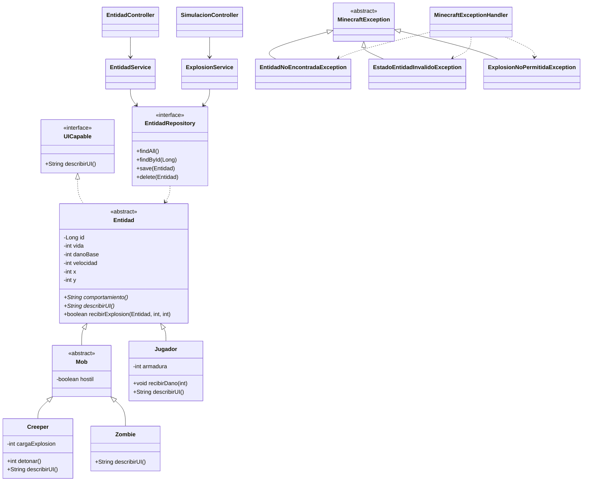

# sgomezdelafuente-talle-git-2026

Nombre: Sebastian Gomez de la Fuente

Usuario GitHub: SGDFM

Comision: CYT646 F

Dominio: Minecraft

Commit de solucion POO-08: se agrega en el siguiente commit documental.

Commit anterior POO-06: https://github.com/SGDFM/sgomezdelafuente-talle-git-2026/commit/6e25498a38db875b3a97d32a17b47dc2e4885234

## Objetivo POO-08

Publicar una API REST con arquitectura de tres capas que persiste `Jugador`, `Creeper` y `Zombie` en H2. El servicio ofrece CRUD polimorfico de `Entidad`, un endpoint basado en la interfaz `UICapable`, una simulacion persistida de explosiones y respuestas HTTP diferentes para cada excepcion del dominio.

## Requisitos

- JDK 21.
- Puerto 8080 disponible.
- Maven Wrapper incluido en el repositorio.

## Licencia

Este proyecto esta licenciado bajo Apache License 2.0. Consulte [LICENSE](LICENSE).

## Como arrancar

```bash
./mvnw spring-boot:run
```

La API queda disponible en:

```text
http://localhost:8080
```

## Configuracion H2

```properties
spring.application.name=minecraft-taller-git-2026
spring.datasource.url=jdbc:h2:file:./data/entidades
spring.datasource.username=sa
spring.datasource.password=
spring.jpa.hibernate.ddl-auto=update
spring.jpa.open-in-view=false
spring.h2.console.enabled=true
```

| Propiedad | Explicacion |
|---|---|
| `spring.datasource.url` | Guarda la base en `./data/entidades`, por lo que los datos permanecen entre reinicios. |
| `spring.datasource.username` | Usa el usuario local `sa` de H2. |
| `spring.datasource.password` | Deja la contrasena vacia solo para desarrollo local. |
| `spring.jpa.hibernate.ddl-auto=update` | Crea o actualiza el esquema sin borrar los datos existentes. |
| `spring.jpa.open-in-view=false` | Cierra el contexto de persistencia antes de serializar la respuesta HTTP. |
| `spring.h2.console.enabled=true` | Habilita la consola web de H2 en desarrollo. |

Consola H2:

```text
http://localhost:8080/h2-console
```

Conexion:

```text
JDBC URL: jdbc:h2:file:./data/entidades
User Name: sa
Password: (vacio)
```

El directorio `data/` esta ignorado por Git.

## Arquitectura

```text
rest/controller -> service -> repository -> H2
       |               |
       v               v
   DTO HTTP        dominio Minecraft
```

- `domain.minecraft`: entidades, reglas e interfaz del dominio.
- `domain.minecraft.exception`: excepciones con nombres de reglas.
- `repository`: interfaces Spring Data JPA.
- `service`: contratos de negocio.
- `service.impl`: validaciones, transacciones y coordinacion del dominio.
- `rest.controller`: traduccion entre HTTP y servicios.
- `rest.dto`: cuerpos de entrada y salida.
- `rest.handler`: conversion de excepciones a JSON y estados HTTP.

El controller no accede directamente al repositorio. La base H2 es la unica fuente de estado del CRUD.

## Familia persistida

`Entidad` es la raiz abstracta. La persistencia usa `SINGLE_TABLE`, porque el CRUD necesita consultar la familia completa y distinguir subtipos en una sola coleccion.

Subtipos persistidos:

- `Jugador`.
- `Creeper`.
- `Zombie`.

La columna discriminadora `tipo_entidad` identifica el subtipo en H2. En HTTP, Jackson usa el campo `tipo` de `EntidadRequest`:

```json
{
  "tipo": "CREEPER",
  "vida": 20,
  "danoBase": 0,
  "velocidad": 2,
  "cargaExplosion": 4
}
```

La creacion no recibe `id`; H2 lo asigna con `GenerationType.IDENTITY`.

JPA necesita un constructor sin argumentos. `Entidad`, `Mob` y `Zombie` lo exponen como `protected`, para que Hibernate pueda hidratar objetos sin convertirlo en una forma publica de crear estados incompletos. `Jugador` y `Creeper` ya conservan constructores simples publicos validos por la consigna de sobrecarga. Los DTO HTTP siempre usan constructores de negocio.

## Endpoints

| Metodo | URL | Resultado |
|---|---|---|
| `GET` | `/` | Confirma que la aplicacion esta activa. |
| `POST` | `/minecraft/sgomezdelafuente/entidades` | Crea un subtipo y responde `201` con su `id`. |
| `GET` | `/minecraft/sgomezdelafuente/entidades` | Lista la familia persistida. |
| `GET` | `/minecraft/sgomezdelafuente/entidades/{id}` | Busca una entidad o responde `404`. |
| `PUT` | `/minecraft/sgomezdelafuente/entidades/{id}` | Reemplaza el estado editable y lo persiste. |
| `DELETE` | `/minecraft/sgomezdelafuente/entidades/{id}` | Elimina la fila y responde `204`. |
| `GET` | `/minecraft/sgomezdelafuente/entidades/ui` | Pide `describirUI()` mediante `UICapable`. |
| `POST` | `/minecraft/sgomezdelafuente/simulaciones/explosion` | Ejecuta y persiste la simulacion. |
| `GET` | `/minecraft/sgomezdelafuente/comportamientos` | Conserva la demostracion polimorfica de POO-06. |

## CURL Del CRUD

Crear Creeper:

```bash
curl -i -X POST http://localhost:8080/minecraft/sgomezdelafuente/entidades \
  -H "Content-Type: application/json" \
  -d '{"tipo":"CREEPER","vida":20,"danoBase":0,"velocidad":2,"cargaExplosion":4}'
```

Listar:

```bash
curl -i http://localhost:8080/minecraft/sgomezdelafuente/entidades
```

Buscar por ID:

```bash
curl -i http://localhost:8080/minecraft/sgomezdelafuente/entidades/1
```

Actualizar con PUT:

```bash
curl -i -X PUT http://localhost:8080/minecraft/sgomezdelafuente/entidades/1 \
  -H "Content-Type: application/json" \
  -d '{"tipo":"CREEPER","vida":20,"danoBase":0,"velocidad":3,"cargaExplosion":5}'
```

Eliminar:

```bash
curl -i -X DELETE http://localhost:8080/minecraft/sgomezdelafuente/entidades/1
```

## Interfaz UICapable

`UICapable` declara el mensaje:

```java
String describirUI();
```

`Entidad` implementa el protocolo y obliga a cada elemento concreto a producir su texto. `Jugador` pertenece a la rama directa de `Entidad`; `Creeper` y `Zombie` pertenecen a la rama `Mob`. De esta forma, el endpoint puede hablar con familias distintas usando el mismo tipo.

Ejemplo de mensaje:

```text
imagen=creeper.png, posicion=(0,0), sonido=siseo, velocidad=2, cargaExplosion=4
```

La imagen y el sonido son textos; no hay archivos binarios. El endpoint `/entidades/ui` recibe entidades vivas desde el service y convierte cada una mediante una referencia `UICapable`.

## Reglas De Explosion

Regla 1: un `Creeper` solo puede detonar si esta vivo y su carga es al menos `3`; el dano base de la explosion es `cargaExplosion * 4`.

Regla 2: una entidad viva recibe el dano solo si su distancia Manhattan al Creeper no supera el radio; `Jugador` aplica su armadura mediante la sobreescritura de `recibirDano()`.

La simulacion involucra un `Creeper`, un `Jugador` y un `Zombie`. Al terminar, el Creeper desaparece, los objetivos cercanos reciben dano y los tres estados se guardan dentro de una transaccion.

Ejemplo:

```bash
curl -i -X POST http://localhost:8080/minecraft/sgomezdelafuente/simulaciones/explosion \
  -H "Content-Type: application/json" \
  -d '{"creeperId":1,"jugadorId":2,"zombieId":3,"radio":5}'
```

Un `GET /entidades` posterior confirma que el resultado permanece en H2.

## Excepciones

La jerarquia usa excepciones no comprobadas porque representan reglas que no pueden recuperarse dentro del metodo que las detecta y Spring puede propagarlas al handler HTTP.

```text
MinecraftException
|- EntidadNoEncontradaException  -> 404 Not Found
|- EstadoEntidadInvalidoException -> 400 Bad Request
`- ExplosionNoPermitidaException -> 409 Conflict
```

El dominio o el service lanza la excepcion correspondiente. `MinecraftExceptionHandler` tiene un metodo `@ExceptionHandler` diferente para cada hija y responde JSON con fecha, estado, tipo, mensaje y ruta.

## Decisiones De Diseno

### Recurso y verbo

El sustantivo principal es `entidades`. La URL identifica la coleccion o un elemento; `POST`, `GET`, `PUT` y `DELETE` expresan la operacion.

### Identidad

`Entidad.id` es la clave primaria. H2 la asigna al insertar, por eso el JSON de creacion la omite.

### Herencia y tablas

Se eligio `SINGLE_TABLE` para consultar la familia polimorfica desde un solo `EntidadRepository`. Las columnas exclusivas de un subtipo pueden ser nulas en filas de otro subtipo; los constructores y el service sostienen los invariantes reales.

### Interfaz y repositorio

`EntidadRepository` es una interfaz Spring Data. El service depende del contrato y no de SQL ni de H2. Si cambia la base compatible con JPA, el dominio y los controllers permanecen iguales.

Ademas del CRUD generado, el repositorio declara `findByVidaGreaterThanOrderByIdAsc(int)`. El service lo usa para entregar al endpoint UI solamente elementos vivos y ordenados.

`UICapable` es el protocolo propio del dominio. Su endpoint pide el mensaje a traves de la interfaz, no mediante condicionales por tipo.

### Ocultamiento

Los DTO de entrada crean objetos mediante constructores. El service rechaza vida inicial no positiva, tipos no persistibles y cambios de subtipo. Los metodos del dominio validan dano, velocidad, armadura, carga y reglas de explosion. Un POST ilegal responde `400` y no inserta una fila.

### PUT

`PUT` recibe todo el estado editable del subtipo. Conserva `id`, posicion y tipo. Un tipo diferente al persistido responde `400`; un campo omitido toma el valor por defecto del JSON y puede ser rechazado por las validaciones.

### DELETE

DELETE significa quitar el recurso de la coleccion persistida. No se usa `desaparecer()`, porque desaparecer es una regla del juego y borrar es una operacion de almacenamiento.

### Dos reglas y simulacion

La carga minima decide si el Creeper puede detonar. El radio decide que objetivos reciben dano. `ExplosionService` coordina la transaccion, pero el calculo y los cambios de estado viven en `Creeper`, `Entidad` y `Jugador`.

Si una regla falla, la excepcion aborta la transaccion. Por eso una explosion sin carga no deja al Creeper ni a los objetivos parcialmente modificados.

### Cambio de base

Al cambiar H2 por otra base JPA se modifican dependencias y propiedades de conexion. Las entidades pueden requerir ajustes de dialecto o estrategia, pero controllers, contratos de service y reglas del dominio permanecen separados.

## Insomnia

Coleccion versionada:

```text
insomnia/poo-08-minecraft.json
```

Importacion:

1. Abrir Insomnia.
2. Elegir Import/Export.
3. Importar `insomnia/poo-08-minecraft.json`.
4. Verificar `base_url=http://localhost:8080`.

Orden de ejecucion:

1. Crear Creeper, Jugador y Zombie.
2. Copiar los IDs devueltos a las variables del entorno.
3. Ejecutar GET de coleccion y GET por ID.
4. Ejecutar PUT y confirmar con otro GET.
5. Ejecutar el endpoint `UICapable`.
6. Ejecutar la simulacion exitosa.
7. Ejecutar GET de coleccion y comprobar el estado persistido.
8. Ejecutar POST ilegal, ID inexistente y explosion sin carga.
9. Ejecutar DELETE y confirmar luego el `404`.

La coleccion contiene un pedido para cada verbo del CRUD, cada hija de la jerarquia de excepciones y cada comportamiento observable exigido.

## Sobrecarga Y Sobreescritura Conservadas

Sobrecarga:

- `Creeper()`, `Creeper(int cargaExplosion)` y constructor completo.
- `Esqueleto()`, `Esqueleto(int flechas)` y constructor completo.
- `Esqueleto.disparar(Jugador)` y `disparar(Jugador, int distancia)`.

Sobreescritura:

- Cada hija implementa `comportamiento()` y `describirUI()`.
- `Jugador` reemplaza `recibirDano(int)` para aplicar armadura.
- `Creeper` reemplaza `desaparecer()` para reiniciar su carga.

La sobrecarga conserva el nombre con otra lista de parametros. La sobreescritura conserva la firma heredada y cambia la implementacion.

## Diagrama



## Pruebas

```bash
./mvnw test
```

Las pruebas cubren dominio, `UICapable`, CRUD persistido, POST ilegal, simulacion, estado posterior y handlers HTTP.
