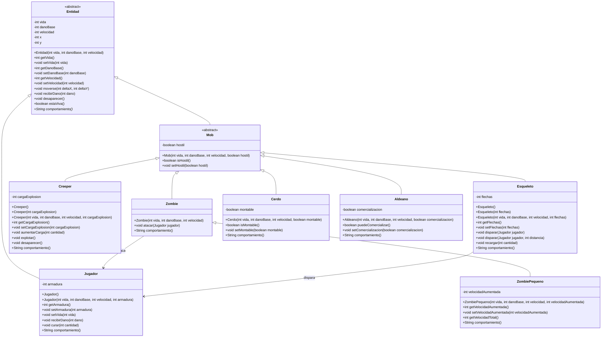

# sgomezdelafuente-talle-git-2026

Nombre: Sebastian Gomez de la Fuente
Usuario GitHub: SGDFM
Comision: CYT646 F

Commit de solucion POO-06: https://github.com/SGDFM/sgomezdelafuente-talle-git-2026/commit/7ae547ed8c618e43e0bf834c34d81a051fbbb7c6

## Como levantar la API

```bash
./mvnw spring-boot:run
```

## Endpoints principales

- `GET /`: estado basico de la API.
- `GET /minecraft/sgomezdelafuente/comportamientos?vida=20&velocidad=2&cargaExplosion=3&flechas=5&comercializacion=true`: construye entidades y devuelve su comportamiento usando el tipo padre `Entidad`.
- `GET /minecraft/sgomezdelafuente/creeper`: estado del creeper.
- `GET /minecraft/sgomezdelafuente/jugador`: estado del jugador.

## Estructura semantica

```text
src/main/java/py/edu/uc/lp3/
├── Application.java
├── domain/minecraft/       # modelo de dominio
└── rest/controller/        # controllers REST
```

## Sobrecarga y sobreescritura

Sobrecarga agregada:

- `Creeper()` y `Creeper(int cargaExplosion)` delegan en `Creeper(int vida, int danoBase, int velocidad, int cargaExplosion)`.
- `Esqueleto()` y `Esqueleto(int flechas)` delegan en `Esqueleto(int vida, int danoBase, int velocidad, int flechas)`.
- `Jugador()` delega en `Jugador(int vida, int danoBase, int velocidad, int armadura)`.
- `Esqueleto.disparar(Jugador jugador)` aplica el dano base.
- `Esqueleto.disparar(Jugador jugador, int distancia)` representa el mismo mensaje del dominio con otro contexto: si la distancia es mayor a 10, el dano baja.

Sobreescritura aplicada:

- `Entidad` declara `comportamiento()` como metodo abstracto.
- `Creeper`, `Aldeano` y `Esqueleto` lo implementan con la misma firma y comportamiento propio.
- `Jugador` sobrescribe `recibirDano(int dano)` para aplicar armadura antes de modificar la vida.
- `Creeper` sobrescribe `desaparecer()` para reiniciar su carga de explosion cuando muere.

La diferencia principal es que la sobrecarga mantiene el mismo nombre con parametros distintos dentro de una clase, mientras que la sobreescritura mantiene la misma firma heredada y cambia la implementacion en una subclase.

## Diagrama de clases


